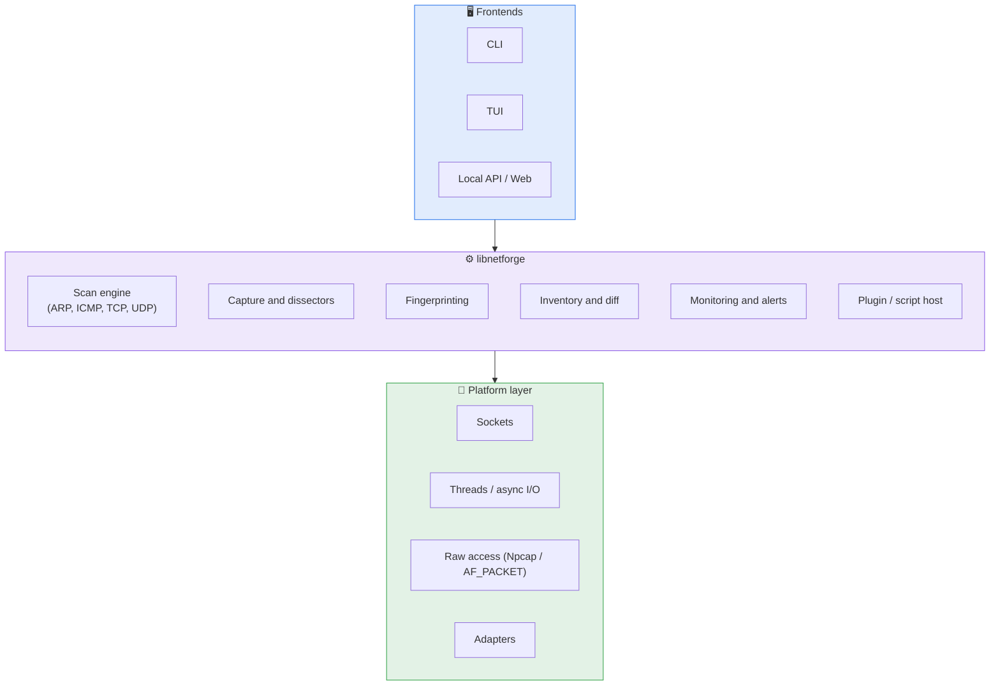

<div align="center">

```
  _   _      _   _____
 | \ | | ___| |_|  ___|__  _ __ __ _  ___
 |  \| |/ _ \ __| |_ / _ \| '__/ _` |/ _ \
 | |\  |  __/ |_|  _| (_) | | | (_| |  __/
 |_| \_|\___|\__|_|  \___/|_|  \__, |\___|
                               |___/
```

### The network toolkit, forged from scratch in C


-0078D6?style=for-the-badge&logo=windows&logoColor=white)


**Discover** · **Scan** · **Capture** · **Fingerprint** · **Monitor** · **Extend**

</div>

---

## 🎯 Vision

One tool that replaces a whole toolbox. Host discovery, port scanning, packet capture, diagnostics,
inventory and continuous monitoring, all on a single fast core that you can drive from the CLI, a TUI,
an API or your own plugins.

No heavy frameworks, no forks: every layer is built in-house.

## ✨ At a glance

| | Feature | Status |
|---|---|---|
| 🔌 | Adapter listing | ✅ done |
| 📡 | ARP sweep (sequential) | ✅ done |
| ⚡ | ARP sweep (multi-threaded) | ✅ done |
| 🔎 | ICMP / TCP / UDP discovery | 🟡 planned |
| 🚪 | Port scanning (connect, SYN, UDP) | 🟡 planned |
| 🦈 | Packet capture and dissection | 🟡 planned |
| 🧬 | OS and service fingerprinting | 🟡 planned |
| 🛡️ | Monitoring and attack detection | 🟡 planned |
| 🧩 | Scripting and plugins | 🟡 planned |
| 🖥️ | TUI, API, web dashboard | 🟡 planned |

## 🏗️ Architecture



### Design principles

- 🧠 **Core library + thin frontends.** All logic lives in `libnetforge`.
- 📦 **Caller-owned memory.** Workers write into slots owned by the caller: no allocation in threads, no hidden globals.
- 🔁 **Portable platform layer.** Win32 first, Linux next, behind one abstraction.
- 🤖 **Machine-readable first.** Tables for humans, JSON/CSV/NDJSON for tools.
- 🚦 **Speed with control.** Async I/O, rate limiting, timing profiles. It never floods by default.
- 🧪 **Testable.** Parsers and dissectors are pure functions, fuzzed against malformed input.

## 🚀 Quick start

```bash
# build (MinGW)
gcc main.c -o netforge.exe -lws2_32 -liphlpapi

# list network adapters
netforge -showinterface

# ARP sweep, sequential
netforge -arpsweep

# ARP sweep, multi-threaded
netforge -arpsweep -mt
```

Example output:

```diff
+ Host : 192.168.30.1     00-1A-2B-3C-4D-5E
+ Host : 192.168.30.17    A4-83-E7-12-9F-01
+ Host : 192.168.30.43    3C-52-82-AA-10-77
! 3 hosts alive on 192.168.30.0/24
```

## 🗺️ Roadmap

```mermaid
gantt
    title NetForge roadmap (order of work, not dates)
    dateFormat  X
    axisFormat  %s
    section Core
    P0 Foundation           :active, p0, 0, 2
    P1 Discovery            :p1, 2, 4
    P2 Port scanning        :p2, 4, 7
    section Analysis
    P3 Capture              :p3, 7, 10
    P4 Fingerprint+Inventory:p4, 10, 13
    P5 Diagnostics          :p5, 13, 15
    section Operations
    P6 Monitoring           :p6, 15, 18
    P7 Security assessment  :p7, 18, 21
    section Platform
    P8 Plugins              :p8, 21, 23
    P9 Interfaces           :p9, 23, 26
    P10 Scale and release   :p10, 26, 29
```



<details open>
<summary><b>🟢 Phase 0: Foundation</b> (in progress)</summary>

- Fix known issues: buffer sizes, thread ownership, adapter enumeration with `ERROR_BUFFER_OVERFLOW`, IPv4/IPv6 filtering
- Split into modules: `net/`, `scan/`, `output/`, `cli/`, `platform/`
- Real argument parser, `-help`, exit codes, error reporting
- Logging levels, build system (CMake or Makefile), unit-test harness, CI
- Interface selection; derive subnet and source IP from IP + prefix length (no hard-coded addresses)

</details>

<details>
<summary><b>🔵 Phase 1: Host discovery</b></summary>

- ARP sweep on any subnet size, configurable workers and timeouts
- ICMP echo sweep, TCP/UDP ping probes
- IPv6 neighbor discovery (NDP), multicast probing
- Reverse DNS, NetBIOS, mDNS, LLMNR, SSDP name resolution
- MAC vendor lookup with an embedded OUI database
- Output: table, JSON, CSV, NDJSON; sorting and filtering

</details>

<details>
<summary><b>🟣 Phase 2: Port scanning engine</b></summary>

- TCP connect scan on an async engine (IOCP on Windows, epoll on Linux)
- Raw-socket SYN scan, FIN/NULL/Xmas variants
- UDP scan with protocol-specific probes
- Targets: CIDR, ranges, lists, files, exclusions
- Timing profiles, adaptive rate limiting, RTT estimation, retransmission
- Banner grabbing and basic service identification

</details>

<details>
<summary><b>🔴 Phase 3: Packet capture and analysis</b></summary>

- Capture through Npcap / AF_PACKET with BPF-style filtering
- Own dissectors: Ethernet, VLAN, ARP, IPv4/IPv6, ICMP, TCP, UDP, DNS, DHCP, HTTP, TLS handshake
- TCP stream reassembly and flow tracking
- pcap / pcapng read and write, live statistics
- Packet crafting and injection (ARP, ICMP, TCP, UDP, custom)

</details>

<details>
<summary><b>🟠 Phase 4: Fingerprinting and inventory</b></summary>

- Passive and active OS fingerprinting (TTL, window, TCP options, DHCP options)
- Service/version detection with a signature database
- Persistent device inventory with history (first/last seen, MAC/IP changes)
- Diff between scans, tagging and grouping
- Reports in HTML, Markdown, JSON

</details>

<details>
<summary><b>🟡 Phase 5: Diagnostics</b></summary>

- Traceroute (ICMP/UDP/TCP) and continuous MTR-style path monitoring
- Latency, jitter, packet-loss statistics
- Path MTU discovery, DNS resolver tests, DHCP discovery
- Throughput test (client/server)
- Wake-on-LAN, port knocking client, WHOIS

</details>

<details>
<summary><b>🟢 Phase 6: Monitoring and detection</b></summary>

- Daemon with scheduled scans
- Alerts for new or missing devices, service up/down
- ARP spoofing, rogue DHCP/DNS, MAC flapping, duplicate IP detection
- Alert sinks: console, file, webhook, syslog, email
- Prometheus metrics export

</details>

<details>
<summary><b>🔴 Phase 7: Security assessment (authorized use)</b></summary>

- TLS inspection: versions, ciphers, certificate checks
- Enumeration: SNMP, SMB, SSH, FTP, HTTP, mDNS
- Rule-driven checks for default credentials and misconfigurations
- Vulnerability matching against detected service versions

</details>

<details>
<summary><b>🟣 Phase 8: Scripting and plugins</b></summary>

- Embedded scripting engine for custom probes and checks
- Stable plugin API (C ABI) for scanners, dissectors and output formats
- Shared rule and signature format

</details>

<details>
<summary><b>🔵 Phase 9: Interfaces</b></summary>

- Interactive TUI: live host table, packet view, scan control
- Local REST/gRPC API exposed by the daemon
- Web dashboard and/or native GUI on top of the API

</details>

<details>
<summary><b>🏁 Phase 10: Scale and release</b></summary>

- Linux and macOS ports
- Distributed agents reporting to a central collector
- Packaging, signed releases, versioning policy
- Full documentation, man pages, benchmarks against existing tools

</details>

## ⚠️ Legal notice

> **Use NetForge only on networks and systems you own or are explicitly authorized to test.**
> Unauthorized scanning or interception may be illegal.

## 📄 License

To be decided.

<div align="center">

*Built one layer at a time, from scratch.* 🔨

</div>
